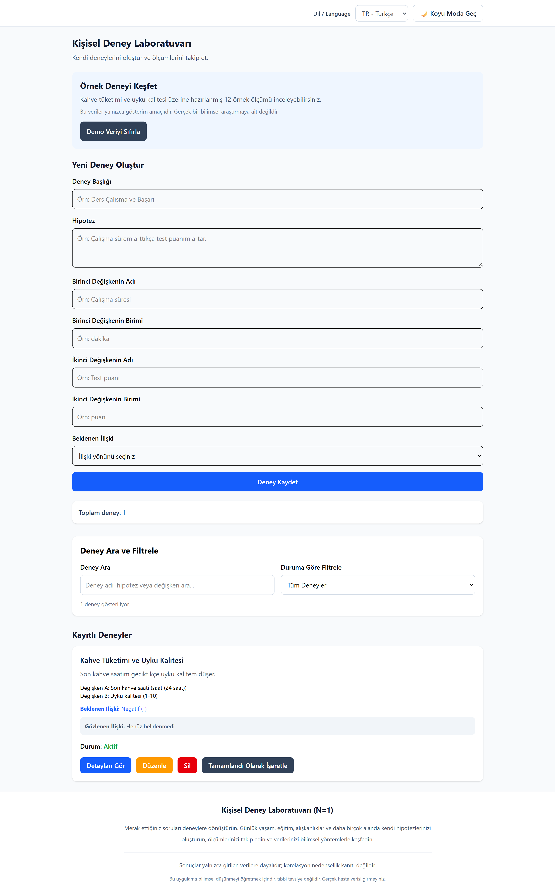
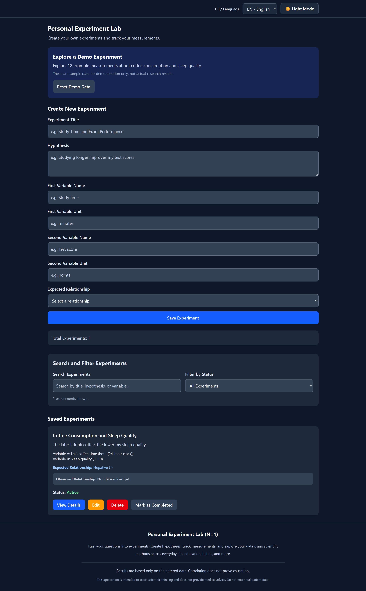
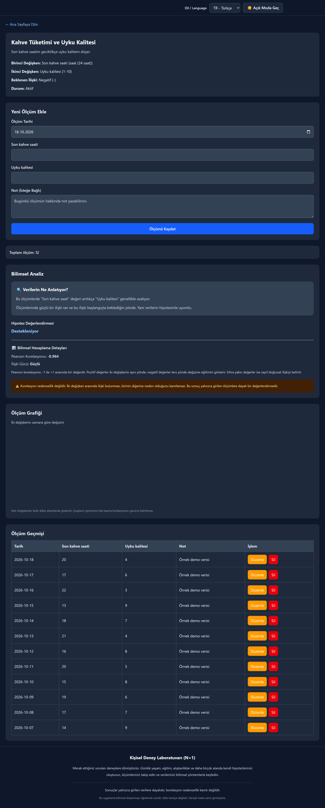
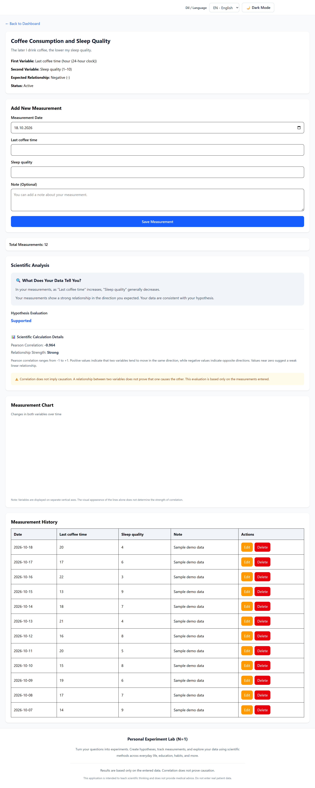

# 🔬 Kişisel Deney Laboratuvarı (N=1)

## Proje Hakkında

Kişisel Deney Laboratuvarı, kullanıcıların günlük yaşam,
eğitim, alışkanlıklar ve farklı ilgi alanlarında kendi
deneylerini oluşturmasına ve ölçümlerini bilimsel
yöntemlerle değerlendirmesine yardımcı olan bir
web uygulamasıdır.

Kullanıcılar hipotez oluşturabilir, iki değişken
belirleyebilir, ölçümlerini kaydedebilir ve sonuçlarını
grafikler ile Pearson korelasyon analizi üzerinden
inceleyebilir.

Uygulama, bilimsel düşünmeyi ve veri okuryazarlığını
desteklemek amacıyla geliştirilmiştir.

## 🚀 Özellikler

- Deney oluşturma, listeleme, düzenleme ve silme
- Günlük ölçüm ekleme, güncelleme ve silme
- localStorage ile kalıcı veri saklama
- Pearson korelasyon katsayısı hesaplama
- Hipotez değerlendirmesi
- Anlaşılır bilimsel analiz açıklamaları
- Recharts ile dinamik grafikler
- Deney arama ve durum filtreleme
- Aktif ve tamamlanan deneylerin takibi
- 12 ölçüm içeren örnek demo deney
- Demo verilerini sıfırlama
- Türkçe ve İngilizce arayüz
- Açık ve koyu tema
- Mobil uyumlu tasarım
- Form doğrulamaları

## 🛠 Kullanılan Teknolojiler

| Teknoloji | Kullanım Amacı |
|-----------|----------------|
| React | Kullanıcı arayüzü |
| TypeScript | Tip güvenliği |
| Vite | Geliştirme ve derleme |
| Tailwind CSS | Arayüz tasarımı |
| React Router | Sayfa yönlendirme |
| Recharts | Veri görselleştirme |
| localStorage | Tarayıcıda veri saklama |
| ESLint | Kod kalite kontrolü |


## 📸 Ekran Görüntüleri

### Ana Sayfa — Türkçe



### Ana Sayfa — İngilizce ve Koyu Mod



### Deney Detayları — Türkçe ve Koyu Mod



### Deney Detayları — İngilizce



## 📊 Bilimsel Analiz

Uygulama, iki sayısal değişken arasındaki doğrusal
ilişkiyi Pearson korelasyon katsayısı ile değerlendirir.

Pearson katsayısı -1 ile +1 arasında değişir.

- Pozitif değer: Aynı yönde doğrusal ilişki
- Negatif değer: Ters yönde doğrusal ilişki
- Sıfıra yakın değer: Zayıf doğrusal ilişki

Uygulamada hesaplama için en az 5 geçerli ölçüm
bulunması gerekmektedir.

Değişkenlerden biri sabitse Pearson korelasyonu
tanımsız olduğundan sonuç hesaplanmaz.

İlişki gücü ve hipotez değerlendirmesi uygulamada
tanımlanan eğitim amaçlı eşiklere göre yapılır.

Önemli: Korelasyon nedenselliği kanıtlamaz.
Analiz sonuçları kesin bilimsel yargılar değildir.

## ☕ Demo Deney

Uygulamada "Kahve Tüketimi ve Uyku Kalitesi"
adlı bir örnek deney bulunmaktadır.

Hipotez:
Son kahve saati geciktikçe uyku kalitesi düşer.

Değişken A: Son kahve saati

Değişken B: Uyku kalitesi (1-10)

Demo deney 12 örnek ölçüm içerir.

Bu veriler sentetiktir ve yalnızca uygulamanın
özelliklerini göstermek amacıyla hazırlanmıştır.

Kullanıcı demo deneyini yükleyebilir, inceleyebilir
ve başlangıç verilerine sıfırlayabilir.

## 💻 Kurulum

Projeyi bilgisayarınızda çalıştırmak için
Node.js ve npm kurulu olmalıdır.

### 1. Bağımlılıkları yükleyin

```bash
npm install
```

### 2. Geliştirme sunucusunu başlatın

```bash
npm run dev
```

### 3. Tarayıcıda açın

http://localhost:5173/

### 4. Yayın sürümünü oluşturun

```bash
npm run build
```

### 5. Kod kontrolünü çalıştırın

```bash
npm run lint
```

## 💾 Veri Saklama

Deneyler, ölçümler, dil ve tema tercihleri
tarayıcının localStorage alanında saklanır.

Sayfa yenilendiğinde kayıtlar korunur.

Veriler bir sunucuya gönderilmez veya
farklı cihazlar arasında senkronize edilmez.

Tarayıcı verileri silinirse kayıtlar kaybolabilir.

## 🌍 Dil ve Tema Desteği

Uygulama Türkçe ve İngilizce arayüz sunar.

Kullanıcı açık ve koyu tema arasında geçiş yapabilir.

Dil ve tema tercihleri localStorage üzerinde korunur.

Kullanıcının kendi oluşturduğu içerikler otomatik
olarak çevrilmez.

## ⚠️ Bilimsel ve Etik Uyarı

Bu uygulama bilimsel düşünme ve veri okuryazarlığı
eğitimi amacıyla hazırlanmıştır.

Tıbbi teşhis veya tedavi önerisi sunmaz.

Gerçek hasta verileri girilmemelidir.

Analizler yalnızca kullanıcının sağladığı
ölçümlere dayanır.

## 📌 Proje Durumu

React ve TypeScript ile geliştirilmiştir.

Production build ve ESLint kontrolleri
başarıyla tamamlanmıştır.

## 📄 Lisans

Bu proje eğitim ve portfolyo amacıyla hazırlanmıştır.
